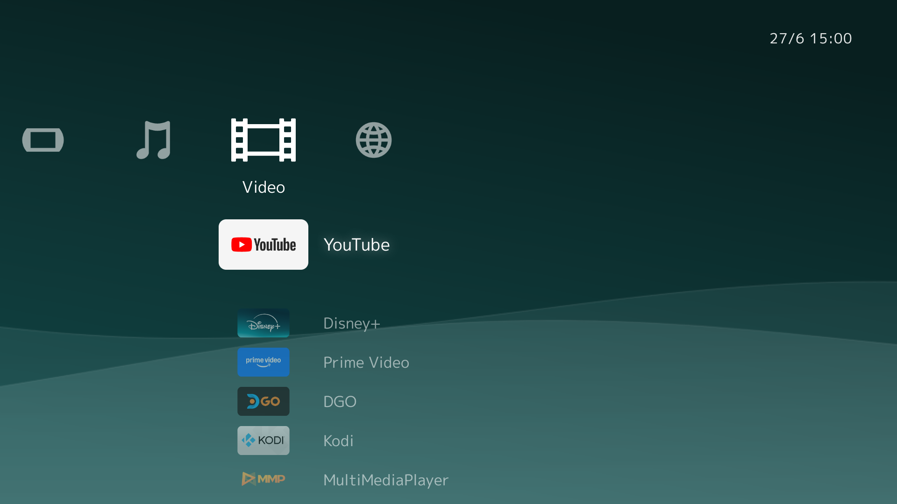

# XMB Home (msrakhra mod)

A PS3-style XMB home screen for Android TV, with a boot sequence, flowing ribbon waves and
sparkles, menu sounds and theme colours. It replaces the stock launcher and runs much lighter
than it.



Based on [amachador/xmb-home](https://github.com/amachador/xmb-home) (MIT). This fork adds:

- **Android 11 support:** `minSdk` lowered from 34 to 30. Nothing in the code needs newer Android.
- **Boot sequence:** fades up from black, the ribbons sweep in from left to right, and a short
  signature line fades in and out in time with a startup sound.
- **PS3-style waves:** twisting translucent ribbons with drifting, twinkling sparkles, drawn at
  full resolution. These replace the original two-sheet PSP waves.
- **Sparkle scatter:** every sparkle bursts outwards when an app opens, and gathers back when you
  return.
- **Menu click:** a sound on every move through the menu, silent at the ends of a row.
- **Theme colour:** a Settings item that cycles through 17 colours, or follows the PS3 month rule.
- **Fonts:** Zen Kaku Gothic New for the menu, the closest free match to the XMB's lettering, and
  Helmet for the boot text.

**Tested on:** Cello Android TV, Android 11.

---

## What you need

- An Android TV or Google TV device running **Android 11 or newer**
- A Windows, macOS or Linux PC on the **same Wi-Fi network** as the TV
- [Android Studio](https://developer.android.com/studio), which includes the Android SDK and a
  compatible Java. Alternatively, use the command-line tools with **JDK 17**.
- [Android SDK Platform-Tools](https://developer.android.com/tools/releases/platform-tools) (`adb`)

The commands below are written for **PowerShell on Windows**. On macOS or Linux, use `./gradlew`
instead of `.\gradlew.bat` and `/` instead of `\` in paths.

---

## Setup

### 1. Turn on debugging on the TV

1. On the TV, open **Settings → Device Preferences → About**.
2. Select **Build** seven times until it says you're a developer.
3. Go back to **Device Preferences → Developer options** and turn on **USB debugging**.
4. Find the TV's IP address under **Settings → Network & Internet → (your network)**.

### 2. Install adb

```powershell
winget install Google.PlatformTools
```

Close and reopen PowerShell, then check that it worked:

```powershell
adb version
```

### 3. Connect to the TV

```powershell
adb connect 192.168.1.42:5555
adb devices
```

Use your TV's IP. An **Allow USB debugging?** prompt appears on the TV: tick *Always allow* and
accept. `adb devices` should then list the TV as `device`.

> If the connection is refused, some TVs need a single USB connection first. Plug the TV in over
> USB, run `adb tcpip 5555`, unplug it, then connect over Wi-Fi as above.

### 4. Get the code

Clone into your user folder. Windows won't let you write inside `C:\Windows`.

```powershell
cd $HOME
git clone https://github.com/<your-username>/xmb-home
cd xmb-home
```

### 5. Add your own sounds and fonts (optional)

| File | What it's for | If you leave it out |
|---|---|---|
| `app/src/main/res/raw/boot_sound.mp3` | Startup sound | Silent placeholder |
| `app/src/main/res/raw/nav_click.mp3` | Menu move click | Silent placeholder |
| `app/src/main/assets/fonts/boot_text.ttf` (or `.otf`) | Font for the boot text only | Uses the UI font |
| `app/src/main/assets/fonts/Rodin-Regular.otf` and `Rodin-Medium.otf` | Your own licensed Rodin, if you have it | Zen Kaku Gothic New (included) |

Keep the names exactly as shown: lowercase, no spaces. To use your own sound, replace the
placeholder file and keep its name. The build registers everything in `res/raw` automatically, so
there's nothing else to set up.

Fonts and sounds are **not included** in this repo unless they're freely licensed. Only add files
you have the rights to use.

### 6. Build the APK

**With Android Studio:** open the `xmb-home` folder, let Gradle sync finish (install anything it
asks for, but decline any Android Gradle Plugin upgrade), then choose **Build → Build APK(s)**.

**From the command line:**

```powershell
.\gradlew.bat assembleDebug
```

Either way, the APK ends up at `app\build\outputs\apk\debug\app-debug.apk`.

> **Build fails with a `jlink` or `JdkImageTransform` error?** Gradle is using a Java that's too
> new. Point it at Android Studio's bundled Java and try again:
>
> ```powershell
> $env:JAVA_HOME = "C:\Program Files\Android\Android Studio\jbr"
> .\gradlew.bat --stop
> .\gradlew.bat assembleDebug
> ```
>
> To make this permanent, add `org.gradle.java.home=C:\\Program Files\\Android\\Android Studio\\jbr`
> to `gradle.properties`.

### 7. Install it on the TV

```powershell
adb install -r app\build\outputs\apk\debug\app-debug.apk
```

Wait for `Success`. Before going further, check that it runs:

```powershell
adb shell am start -n com.oso.xmbhome/.MainActivity
```

### 8. Make it the home screen

```powershell
adb shell cmd package set-home-activity com.oso.xmbhome/.MainActivity
adb shell input keyevent KEYCODE_HOME
```

If Home still opens the old launcher, or the first command says **Failed to set default home**,
disable the stock launcher instead. First, find out which app currently handles Home:

```powershell
adb shell cmd package resolve-activity -a android.intent.action.MAIN -c android.intent.category.HOME
```

Then disable it, using the package name it printed. On most Android TVs this is
`com.google.android.tvlauncher`:

```powershell
adb shell pm disable-user --user 0 com.google.android.tvlauncher
adb shell input keyevent KEYCODE_HOME
```

> **Only do this once XMB Home is installed and has opened successfully.** If you disable the
> stock launcher with nothing to replace it, Home leads to a blank screen until you re-enable it.
> Keep the undo command from [Going back](#going-back) somewhere safe.

### 9. Fix the remote's Settings button (optional)

With the stock launcher disabled, the remote's Settings button may stop working. XMB Home
includes a small accessibility service that only listens for that key:

```powershell
adb shell settings put secure enabled_accessibility_services com.oso.xmbhome/com.oso.xmbhome.KeyHelperService
adb shell settings put secure accessibility_enabled 1
```

---

## Applying changes

After you edit anything, run the same four steps:

```powershell
.\gradlew.bat assembleDebug
adb install -r app\build\outputs\apk\debug\app-debug.apk
adb shell am force-stop com.oso.xmbhome
adb shell input keyevent KEYCODE_HOME
```

The last two restart the launcher, so you see the boot sequence again without turning the TV off.

---

## Customising

**`app/src/main/res/values/config.xml`**

| Setting | What it does |
|---|---|
| `boot_text` | The boot signature line. Leave it empty to skip the boot sequence. |
| `boot_on_screen_on` | `true` plays the boot every time the screen turns on. `false` plays it only after a full reboot. |
| `boot_text_in_ms` | When the text starts fading in, in ms after the sound starts |
| `boot_text_fade_ms` | How long each fade takes |
| `nav_click_volume` | Click volume from 0 to 100 (0 turns it off) |
| `music_packages`, `apps_packages` | Which apps go in the Music and Apps columns |
| `video_first` | Apps pinned to the top of the Video column, in order |
| `hidden_packages` | Apps never shown |

**`WaveView.java`** (constants at the top)

| Constant | What it does |
|---|---|
| `RIBBONS`, `SPARKS` | How many ribbons and sparkles. Lower these if the menu stutters. |
| `WAVE_Y` | The wave's vertical position |
| `WAVE_AMP` | How wavy it is |
| `WAVE_SPEED` | How fast it flows |

**`MainActivity.java`**

| Setting | What it does |
|---|---|
| `bootText = text(20, false)` | Boot text size. `true` makes it bolder. |
| `blp.rightMargin = px(64)` | Gap between the boot text and the right edge |
| `BOOT_MENU_EARLY` | How much earlier, in ms, the menu rises while the boot text is fading out |
| `BOOT_REVEAL_MS` | How long the left-to-right ribbon sweep takes |

**Live TV:** the Live TV item opens the MediaTek TV app. If it does nothing on your TV, list your
TV packages with `adb shell pm list packages | findstr -i tv`, then change the package name in
`Catalog.java`.

---

## Going back

Re-enable the stock launcher **first**, then remove XMB Home:

```powershell
adb shell pm enable com.google.android.tvlauncher
adb uninstall com.oso.xmbhome
```

A TV software update can sometimes re-enable the stock launcher. If that happens, run the
`pm disable-user` command from step 8 again.

---

## Troubleshooting

| Problem | Fix |
|---|---|
| `adb` isn't recognised | Close and reopen PowerShell after installing it |
| `adb devices` shows `unauthorized` | Accept the prompt on the TV, then run `adb connect` again |
| `INSTALL_FAILED_OLDER_SDK` | Your TV runs Android 10 or older, which this fork doesn't support |
| `failed to stat ... No such file` | You're in the wrong folder. `cd` into `xmb-home` first, or use the full path to the APK. |
| `Failed to set default home` | Make sure the install finished first, then use the `pm disable-user` route in step 8 |
| Home shows a blank screen | Run `adb shell pm enable com.google.android.tvlauncher` |
| Crashes on open | Run `adb logcat -d -s AndroidRuntime` and check the error |
| Menu stutters | Lower `RIBBONS` and `SPARKS` in `WaveView.java` |

---

## Credits and licence

- **Original project:** [XMB Home](https://github.com/amachador/xmb-home) by amachador, MIT.
  The original copyright notice is kept in [`LICENSE`](LICENSE).
- **Fork changes:** msrakhra.
- **Icons:** redraws of the XMB icons by sah4pok,
  [CC BY 4.0](https://creativecommons.org/licenses/by/4.0/). See [`CREDITS.md`](CREDITS.md).
- **Fonts:** [Zen Kaku Gothic New](https://fonts.google.com/specimen/Zen+Kaku+Gothic+New) for the menu,
  Helmet by Carl Enlund for the boot text, and
  [M PLUS 1p](https://fonts.google.com/specimen/M+PLUS+1p) as a fallback, all under the SIL Open Font
  License 1.1.

PlayStation, PSP and XMB are trademarks of Sony Interactive Entertainment. This is a fan project
and is not affiliated with or endorsed by Sony.
